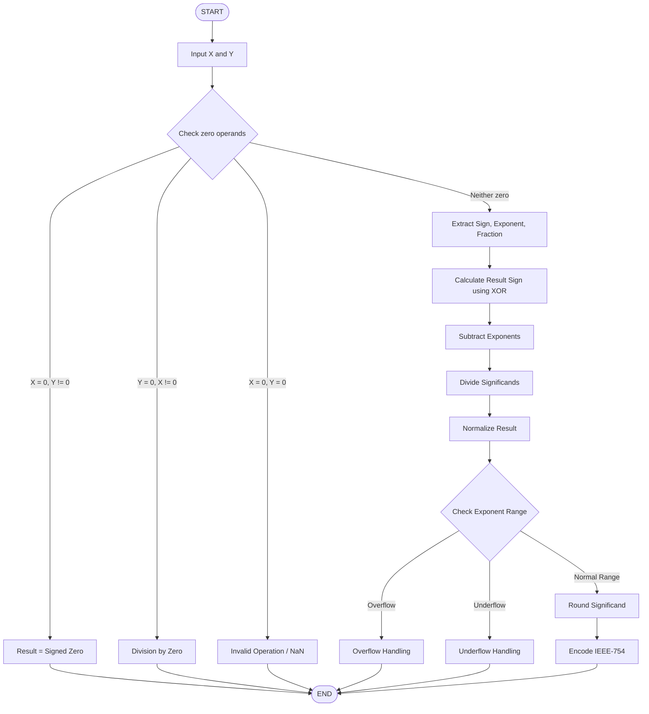

# IEEE-754 Single-Precision Operations in Registers

> **Pattern ID:** PAT-DL-017  
> **Subject:** Digital Logic / Computer Organization  
> **Topic:** IEEE-754 Floating-Point Representation  
> **Priority:** HIGHLY REPEATED  
> **Frequency:** 5 of 11 years  
> **Repeat Years:** 2020, 2022, 2023, 2025, 2026  
> **Tags:** #GATE #DigitalLogic #IEEE754 #FloatingPoint #SinglePrecision #Hexadecimal #RepeatedPYQ

---

## 1. Original GATE Question

**GATE 2020 CS – Q29 – MCQ – 2 Marks**

Consider three registers R1, R2, and R3 that store numbers in IEEE-754 single-precision floating-point format. Assume that R1 and R2 contain the values (in hexadecimal notation) `0x42200000` and `0xC1200000`, respectively.

If

\[
R3 = \frac{R1}{R2}
\]

What is the value stored in R3?

**Options:**

- (A) `0x40800000`
- (B) `0xC0800000`
- (C) `0x83400000`
- (D) `0xC8500000`

**Correct Answer: (B) 0xC0800000**

---

## 2. Important IEEE-754 Notes

IEEE-754 single precision uses 32 bits.

| Field | Bits | Description |
|---|---:|---|
| Sign | 1 | Positive or negative |
| Exponent | 8 | Biased exponent |
| Fraction | 23 | Mantissa fraction |

### Formula

\[
Value=(-1)^S \times (1.F)_2 \times 2^{E-127}
\]

Where:

- S = Sign bit
- E = Stored exponent
- 127 = Exponent bias
- F = Fraction field
- 1.F = Normalized significand

### Important rules

1. Single precision = 32 bits.
2. Sign bit = 1 bit.
3. Exponent = 8 bits.
4. Fraction = 23 bits.
5. Bias = 127.
6. Normalized numbers have an implicit leading 1.
7. Multiplication adds exponents.
8. Division subtracts exponents.
9. Addition and subtraction require exponent alignment.

---

## 3. Step-by-Step Solution

### Step 1: Decode R1

Given:

`R1 = 0x42200000`

Binary representation:

```text
0 | 10000100 | 01000000000000000000000
S   Exponent           Fraction
```

Sign:

\[
S=0 \Rightarrow Positive
\]

Exponent:

\[
10000100_2=132
\]

Actual exponent:

\[
132-127=5
\]

Significand:

\[
1.010_2=1.25
\]

Therefore:

\[
R1=1.25\times2^5
\]

\[
\boxed{R1=40}
\]

### Step 2: Decode R2

Given:

`R2 = 0xC1200000`

Binary representation:

```text
1 | 10000010 | 01000000000000000000000
S   Exponent           Fraction
```

Sign:

\[
S=1 \Rightarrow Negative
\]

Exponent:

\[
10000010_2=130
\]

Actual exponent:

\[
130-127=3
\]

Significand:

\[
1.010_2=1.25
\]

Therefore:

\[
R2=-1.25\times2^3
\]

\[
\boxed{R2=-10}
\]

### Step 3: Perform Division

\[
R3=\frac{R1}{R2}
\]

\[
R3=\frac{40}{-10}
\]

\[
\boxed{R3=-4}
\]

### Step 4: Convert -4 into IEEE-754

First convert 4 into binary:

\[
4_{10}=100_2
\]

Normalize:

\[
100_2=1.0_2\times2^2
\]

Now calculate the fields.

**Sign bit:**

\[
S=1
\]

**Biased exponent:**

\[
E=2+127=129
\]

\[
129_{10}=10000001_2
\]

**Fraction:**

```text
00000000000000000000000
```

Combine:

```text
1 | 10000001 | 00000000000000000000000
```

Convert into hexadecimal:

```text
1100 0000 1000 0000 0000 0000 0000 0000
  C    0    8    0    0    0    0    0
```

Final answer:

\[
\boxed{0xC0800000}
\]

**Correct Option: (B)**

---

## 4. Fast Method: IEEE-754 Division

For normalized floating-point numbers:

\[
\frac{X}{Y}
=
(-1)^{S_X\oplus S_Y}
\times
\frac{M_X}{M_Y}
\times
2^{e_X-e_Y}
\]

Where:

- Sign = XOR of sign bits.
- Mantissa = Division of significands.
- Exponent = Subtraction of actual exponents.

### Apply to this question

Sign:

\[
0\oplus1=1
\]

Mantissa:

\[
1.25/1.25=1
\]

Exponent:

\[
5-3=2
\]

Result:

\[
-1\times1\times2^2=-4
\]

---

## 5. Floating-Point Arithmetic: Important Notes

### Multiplication

\[
X\times Y =
(-1)^{S_X\oplus S_Y}
\times M_XM_Y
\times2^{e_X+e_Y}
\]

- Multiply significands.
- Add actual exponents.
- XOR sign bits.
- Normalize the result.

### Division

\[
X/Y =
(-1)^{S_X\oplus S_Y}
\times\frac{M_X}{M_Y}
\times2^{e_X-e_Y}
\]

- Divide significands.
- Subtract actual exponents.
- XOR sign bits.
- Normalize the result.

### Addition and Subtraction

Before adding or subtracting:

1. Compare exponents.
2. Align exponents.
3. Shift the significand of the number with the smaller exponent.
4. Add or subtract significands.
5. Normalize the result.
6. Round if required.

**Important:** Multiplication and division generally require less exponent-alignment work than addition and subtraction.

---

## 6. IEEE-754 Division Algorithm



### Algorithm Summary

1. Start.
2. Check zero operands.
3. Extract sign, exponent and fraction.
4. Calculate sign using XOR.
5. Subtract exponents.
6. Divide significands.
7. Normalize the result.
8. Check overflow and underflow.
9. Round the significand.
10. Encode the final result.
11. End.

**IEEE-754 note:** Division by zero, zero divided by zero, overflow and underflow follow IEEE-754 exceptional-value rules.

---

## 7. Repeated Question Analysis

**Pattern ID: PAT-DL-017**

| Year | Pattern |
|---|---|
| 2020 | IEEE-754 operations on registers |
| 2022 | IEEE-754 operations on registers |
| 2023 | IEEE-754 operations on registers |
| 2025 | IEEE-754 operations on registers |
| 2026 | IEEE-754 operations on registers |

**Frequency:** 5 of 11 years, according to the supplied pattern summary.

**Question Type:**

- Floating-point arithmetic
- Hexadecimal conversion
- Register operations
- Exponent alignment
- Significand calculation
- IEEE-754 encoding

**Preparation Priority:** HIGH

Note: This is recurrence of a question pattern, not confirmation that the exact same numerical question appeared in every listed year.

---

## 8. Common GATE Exam Traps

| Mistake | Correct Approach |
|---|---|
| Using stored exponent directly | Subtract bias 127 |
| Forgetting implicit 1 | Use 1.F for normalized values |
| Adding exponents during division | Subtract exponents |
| Ignoring sign | XOR sign bits |
| Forgetting normalization | Normalize before encoding |
| Ignoring rounding | Apply required IEEE-754 rounding |
| Confusing binary and hexadecimal | Group binary into 4-bit blocks |

---

## 9. Quick Revision Table

| Operation | Sign | Exponent | Significand |
|---|---|---|---|
| Addition | Compare signs | Align | Add/subtract |
| Subtraction | Compare signs | Align | Subtract/add |
| Multiplication | XOR | Add | Multiply |
| Division | XOR | Subtract | Divide |

---

## 10. Self-Test

1. What is the exponent bias in IEEE-754 single precision?
2. What is the actual exponent if the stored exponent is 130?
3. What is the sign of negative divided by positive?
4. In floating-point division, are exponents added or subtracted?
5. How many bits are used for the fraction?
6. What is the IEEE-754 hexadecimal representation of -4?

### Answers

1. 127
2. 3
3. Negative
4. Subtracted
5. 23 bits
6. 0xC0800000

---

## 11. Final Revision Takeaway

```text
DECODE
   |
   v
EXTRACT SIGN, EXPONENT, FRACTION
   |
   v
CALCULATE ACTUAL EXPONENT
   |
   v
PERFORM ARITHMETIC
   |
   v
NORMALIZE
   |
   v
CHECK OVERFLOW / UNDERFLOW
   |
   v
ROUND IF REQUIRED
   |
   v
ENCODE IEEE-754
   |
   v
CONVERT TO HEXADECIMAL
```

**Remember:**

- Multiplication → Add exponents.
- Division → Subtract exponents.
- Addition/Subtraction → Align exponents.
- Sign → XOR for multiplication and division.
- Single precision → 1 + 8 + 23 bits.
- Bias → 127.

**Tags:**  
#GATE2027 #GATECSE #DigitalLogic #COA #IEEE754  
#FloatingPoint #BinaryArithmetic #Hexadecimal #RepeatedPYQ  
#SinglePrecision #Division #Normalization #Overflow #Underflow
